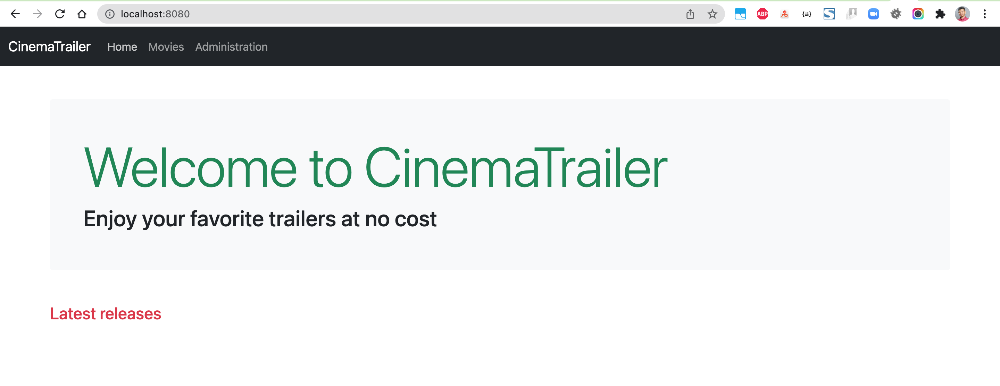
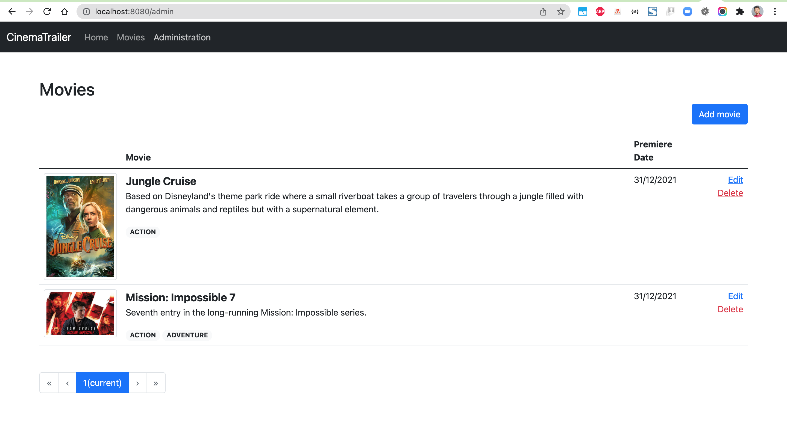
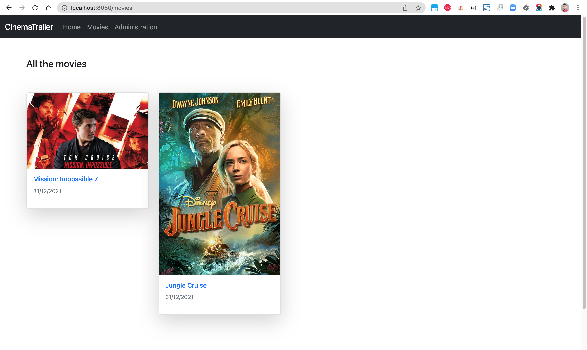
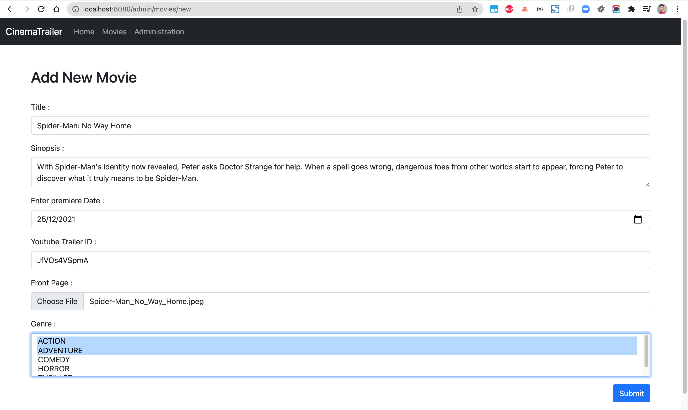
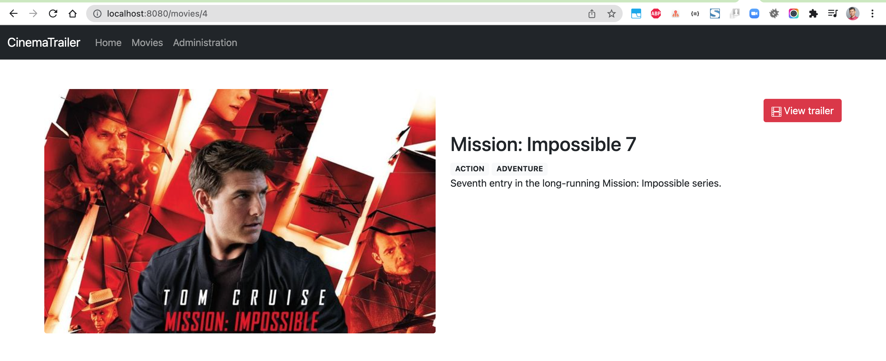
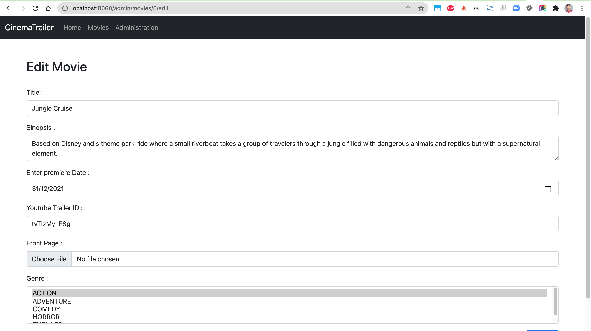

# spring-boot-movie-trailers

[](https://github.com/hendisantika/spring-boot-movie-trailers/actions/workflows/maven.yml)


A movie trailer catalogue built with Spring Boot, Thymeleaf and PostgreSQL. It has a public page for browsing trailers
and an admin area for managing movies, genres and uploaded files.

### Tech Stack

- Java 25 (LTS)
- Spring Boot 4.1 (Web MVC, Data JPA, Validation, Thymeleaf)
- PostgreSQL 17
- springdoc-openapi (Swagger UI)
- Testcontainers 2 for integration tests
- Jib & Docker for container images

### Prerequisites

- JDK 25
- Docker (used to start PostgreSQL automatically and to run the tests)

### Things todo list:

1. Clone this repository: `git clone https://github.com/hendisantika/spring-boot-movie-trailers.git`
2. Navigate to the folder: `cd spring-boot-movie-trailers`
3. Run the application: `./mvnw clean spring-boot:run`

   `spring-boot-docker-compose` starts the PostgreSQL container defined in `compose.yml` for you.
4. Open your favorite browser: http://localhost:8080
5. API docs (Swagger UI): http://localhost:8080/swagger-ui.html

### Running Tests

The tests use Testcontainers to start a real PostgreSQL instance, so Docker must be running:

```bash
./mvnw verify
```

### Docker Compose Deployment

You can also start the PostgreSQL service using Docker Compose:

```bash
docker compose up -d
```

### Building a Container Image

Using the Dockerfile (Eclipse Temurin 25):

```bash
docker build -t movie-trailers .
```

Or using Jib without a Docker daemon:

```bash
./mvnw -DskipTests package jib:build -Djib.to.image=<your-registry>/movie-trailers
```

### CI/CD

- **GitHub Actions** (`.github/workflows/maven.yml`) builds and tests the project on JDK 25 for every push and pull
  request to `main`. Pushes to `main` also publish multi-arch (`linux/amd64`, `linux/arm64`) images to Docker Hub and
  Cloud Raya, and submit the dependency graph.
- **Dependabot** (`.github/dependabot.yml`) checks Maven dependencies daily and GitHub Actions, the Dockerfile and Docker
  Compose images weekly. Related updates are grouped (Spring Boot, testing, Maven plugins, minor/patch) and use
  conventional commit prefixes.

### Kubernetes Deployment

For deploying the application on Kubernetes, refer to the [Kubernetes Deployment Guide](k8s/README.md).

### Image Screen Shot

Home Page



Admin Page



Movies List



Add New Movie



Details Movie



Edit Movie


